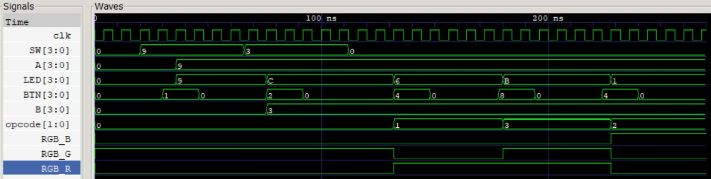
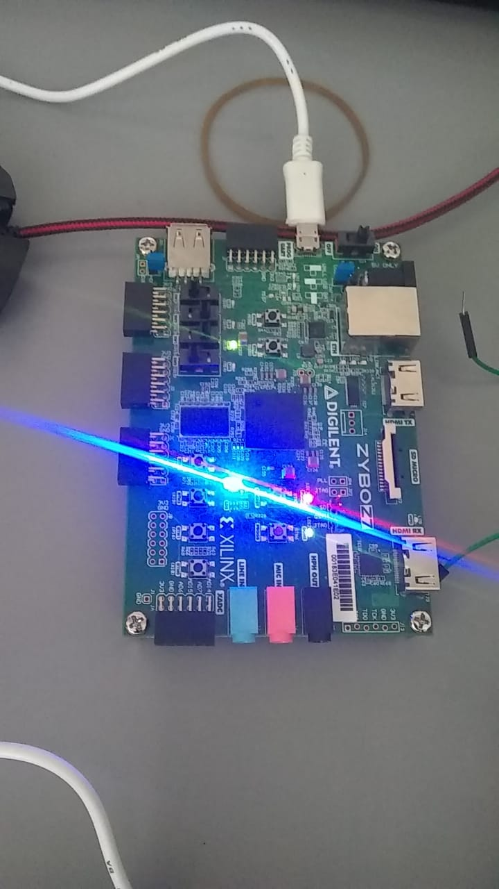
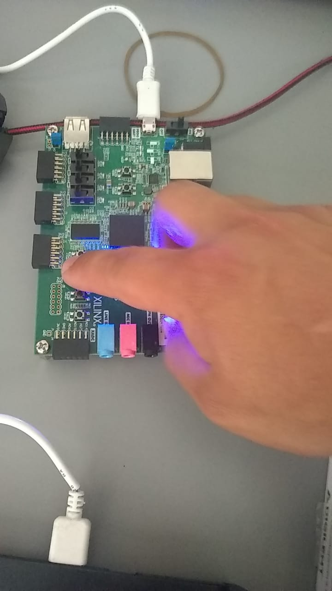
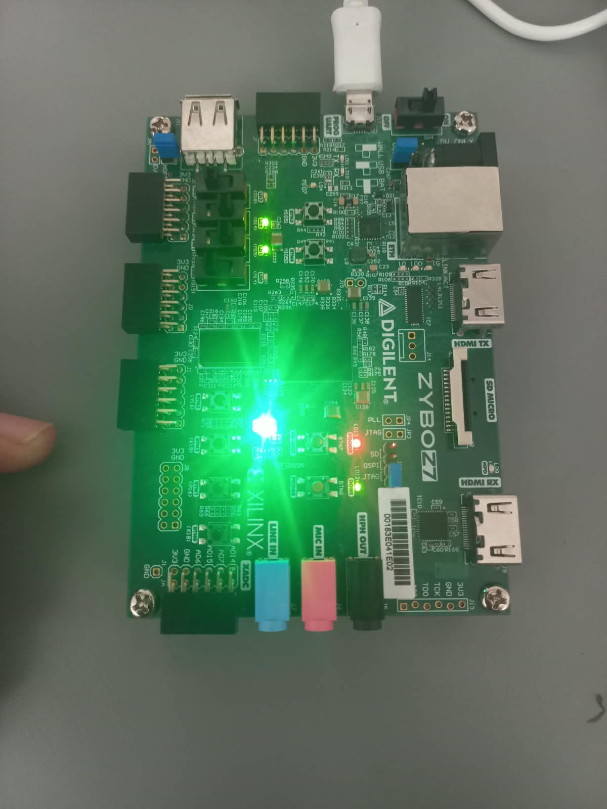
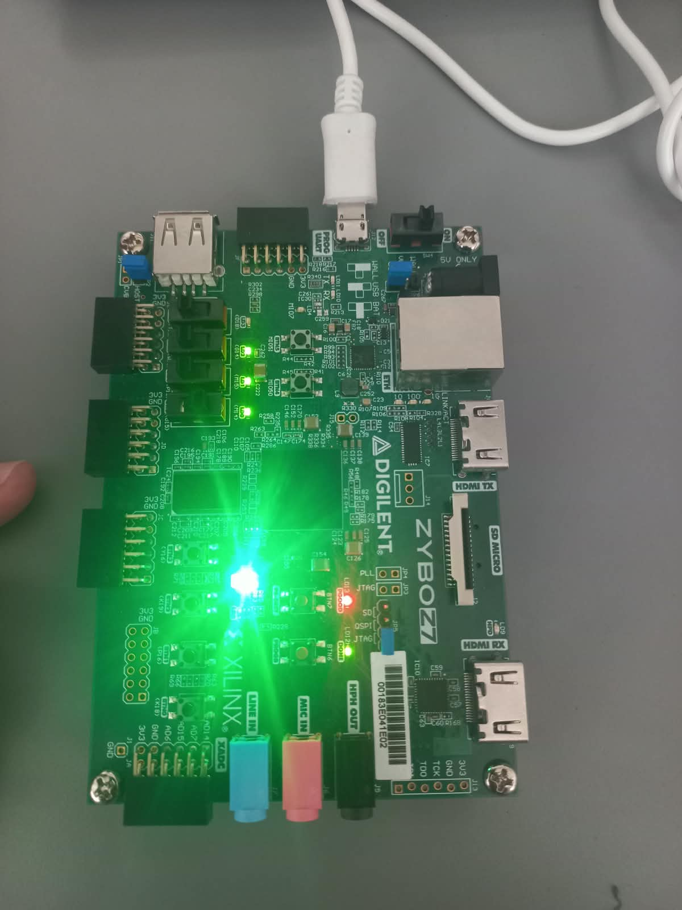
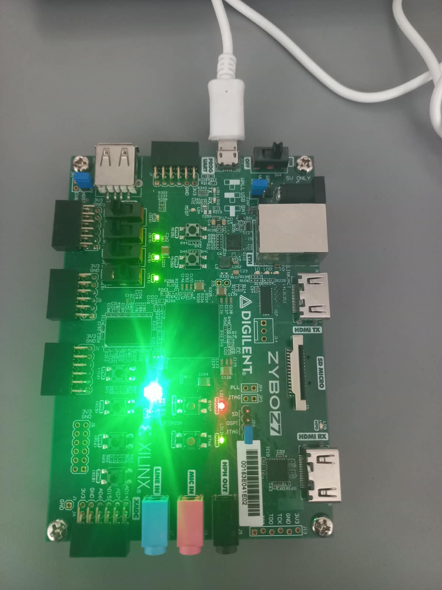
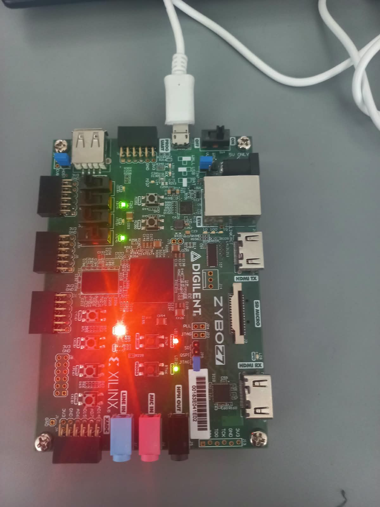
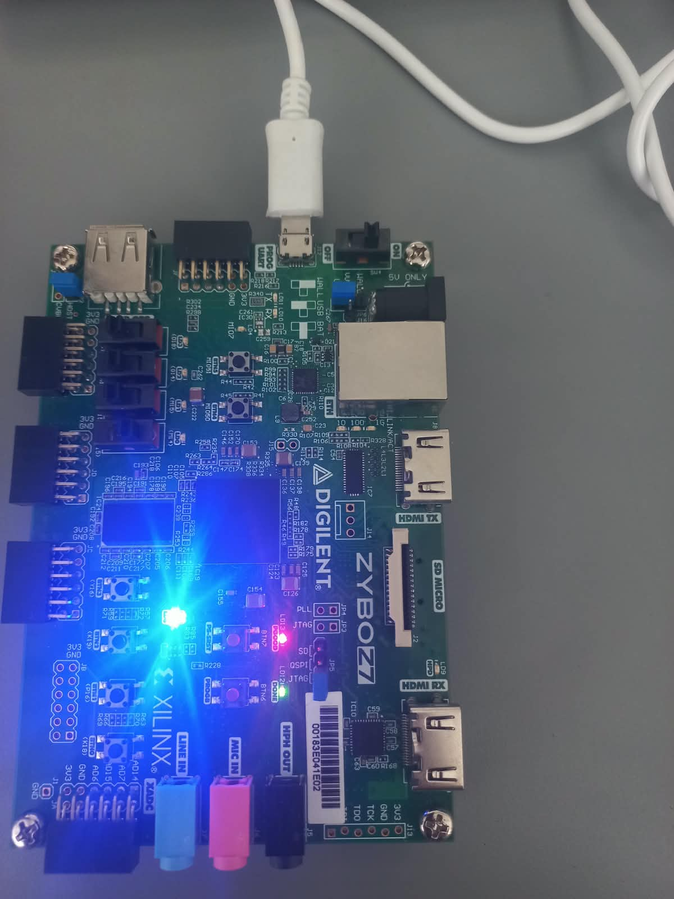
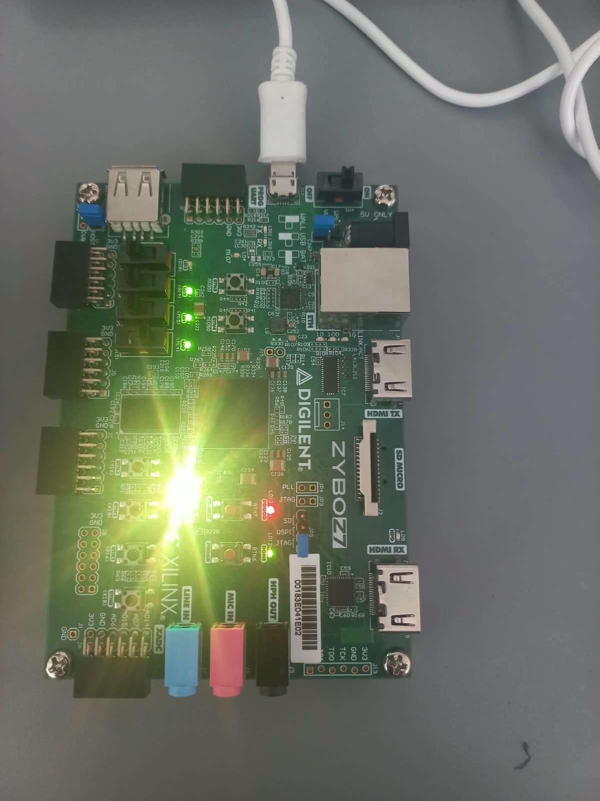

# Laboratorio 02 - Diseño, simulación e implementación de una ALU de 4 bits

### NOMBRES PARTICIPANTES

- Jhohan Stiven Rodríguez Rodríguez
- Alejandro Brandon Prieto León
- Ángel Alirio Rivera Amortegui

## 1. Explicación general del funcionamiento del sistema

El sistema desarrollado corresponde a una **Unidad Aritmético Lógica (ALU) de 4 bits** implementada sobre la tarjeta de desarrollo **Zybo Z7-20** (FPGA Zynq-7000). El objetivo principal del sistema es procesar dos operandos de 4 bits (`A` y `B`) mediante cuatro operaciones distintas (Suma, Resta, AND y OR), mostrando el resultado en un conjunto de LEDs y el estado de la operación mediante un LED RGB.

El funcionamiento general del sistema se divide en tres etapas principales:

1. **Captura y Almacenamiento de Datos (Entradas):**
   * El sistema utiliza los 4 conmutadores de la tarjeta (`SW0` a `SW3`) como un bus de entrada de datos común.
   * Los operandos `A` y `B` se capturan en registros internos mediante sincronización por reloj (125 MHz). Al presionar el botón `BTN0`, el valor actual de los switches se almacena en el registro `A`. Al presionar el botón `BTN1`, el valor se almacena en el registro `B`.
   * El código de operación (`opcode` de 2 bits) se gestiona de forma persistente a través de los botones `BTN2` y `BTN3`, los cuales alternan los bits individualmente mediante detectores de flanco de subida.

## 2. **Procesamiento de Datos (ALU):**
   * Los registros de los operandos `A` y `B`, junto con el registro de `opcode`, se entregan al módulo combinacional de la ALU (`alu.v`).
   * La ALU ejecuta la operación seleccionada de forma instantánea según el `opcode`:
     * `00`: Suma (`A + B`)
     * `01`: Resta (`A - B`)
     * `10`: Operación lógica AND bit a bit (`A & B`)
     * `11`: Operación lógica OR bit a bit (`A | B`)

# 3. **Visualización de Resultados (Salidas):**
   * **LEDs Verdes (`LED0` - `LED3`):** Muestran directamente el resultado de 4 bits calculado por la ALU.
   * **LED RGB (`RGB_R`, `RGB_G`, `RGB_B`):** Codifica visualmente la operación seleccionada en la ALU para facilitar la identificación del estado actual del sistema (Verde = Suma, Rojo = Resta, Azul = AND, Amarillo = OR).
## 4. Tabla de operaciones implementadas

La Unidad Aritmético Lógica (`alu.v`) evalúa los operandos de 4 bits `A` y `B` mediante lógica combinacional, guiada por el código de operación (`opcode`) de 2 bits. A continuación se detallan las operaciones implementadas:

| Operación | Código de Operación (`opcode`) | Expresión | Descripción |
| :---: | :---: | :---: | :--- |
| **Suma** | `00` | `result = A + B;` | Realiza la adición aritmética entre `A` y `B`. |
| **Resta** | `01` | `result = A - B;` | Realiza la sustracción aritmética de `A` menos `B`. |
| **AND** | `10` | `result = A & B;` | Realiza una operación lógica AND bit a bit. |
| **OR** | `11` | `result = A` | `B;` | Realiza una operación lógica OR bit a bit. |

---

## 5. Explicación de la forma en que se almacenan los operandos

El almacenamiento de los operandos se realiza mediante un esquema de **bus compartido de entrada de datos** conectado a **Flip-Flops de tipo D con habilitador**, los cuales operan de forma síncrona con el flanco de subida del reloj del sistema (`clk` a 125 MHz).

1. **Multiplexión mediante Bus Único:** Se utilizan únicamente 4 conmutadores físicos (`SW[3:0]`) para ingresar los datos tanto de `A` como de `B`.
2. **Lógica de Carga (Enable):** 
   * Cuando se presiona el botón **BTN0** (`if (BTN[0])`), en el siguiente flanco activo del reloj el valor presente en la entrada `SW` se transfiere al registro interno `reg [3:0] A`.
   * Al presionar el botón **BTN1** (`if (BTN[1])`), el valor de `SW` se transfiere al registro interno `reg [3:0] B`.
3. **Persistencia:** Una vez liberado el botón correspondiente, las asignaciones no entran en sus bloques de actualización, reteniendo el valor capturado en los Flip-Flops hasta una nueva captura, sin importar si la posición de los conmutadores `SW` cambia posteriormente.

---

## 6. Explicación de la forma en que se conserva el código de operación

Para mantener y seleccionar el código de operación (`reg [1:0] opcode`) de 2 bits sin necesidad de conmutadores dedicados, se implementó el mecanismo de **conmutación de estado persistente por detección de flanco de subida** sobre los botones `BTN2` y `BTN3`:

1. **Registros Auxiliares para Flanco:** Se emplean las señales auxiliares `btn2_prev` y `btn3_prev` para registrar en cada ciclo de reloj el estado previo de los botones.
2. **Detección de Flanco de Subida:** En el bloque secuencial controlado por `posedge clk`, la condición `BTN[2]` identifica de manera precisa el momento exacto en el que el botón pasa de un estado bajo (`0`) a un estado alto (`1`).
3. **Alternancia de Bits (Toggle):** 
   * Cada pulso detectado en **BTN2** invierte el bit menos significativo: `opcode[0] <= ~opcode[0]`.
   * Cada pulso detectado en **BTN3** invierte el bit más significativo: `opcode[1] <= ~opcode[1]`.
4. **Persistencia:** Puesto que las asignaciones solo ocurren durante el ciclo exacto del flanco ascendente, el registro `opcode` mantiene intacto su valor de 2 bits entre pulsaciones, asegurando que la operación seleccionada se conserve estable mientras la ALU opera.
   
## 7. Tabla con los colores utilizados para identificar cada operación mediante el LED RGB

El sistema incluye una decodificación visual mediante el LED RGB de la tarjeta Zybo Z7 para indicar de forma clara e instantánea la operación activa en la ALU. Las señales de control `RGB_R`, `RGB_G` y `RGB_B` son asignadas por el bloque combinacional en `top_lab02.v` en función del valor retenido en `opcode`:

| Operación | Código (`opcode`) | Color del LED RGB | `RGB_R` | `RGB_G` | `RGB_B` | Descripción del estado |
| :---: | :---: | :---: | :---: | :---: | :---: | :--- |
| **Suma** | `00` | **Verde** | `0` | `1` | `0` | Indica la realización de adición (A + B). |
| **Resta** | `01` | **Rojo** | `1` | `0` | `0` | Indica la realización de sustracción (A - B). |
| **AND** | `10` | **Azul** | `0` | `0` | `1` | Indica la realización de operación lógica AND (A & B). |
| **OR** | `11` | **Amarillo** | `1` | `1` | `0` | Mezcla de canales Rojo y Verde para operación OR (A \| B). |
---
## 8. Capturas de GTKWave

### 8.1. Simulación General

### 8.2. Casos de Prueba Específicos

#### Caso de Prueba 1: Verificación de Selección de Operación (`Caso1.jpeg`)
Muestra la verificación del estado físico de la FPGA durante la ejecución del caso de prueba 1, donde se valida la respuesta de las salidas del sistema ante la conmutación del código de operación.

#### Caso de Prueba 2: Verificación de Entrada de Datos y Pulsación de Botones (`Caso2.jpeg`)
Muestra la captura durante la aplicación de los estímulos de entrada mediante la pulsación del botón correspondiente, validando el almacenamiento correcto en el registro objetivo.

## 9. Explicación del comportamiento observado durante la simulación

En el marco de pruebas (`tb_lab02.v`), la simulación de tiempo de corrida valida el correcto funcionamiento síncrono del *datapath* y la respuesta combinacional de la ALU frente a las señales generadas por el archivo de simulación `waveform_lab02.vcd`:

1. **Inicialización (t = 0 ns a 20 ns):**
   * El reloj genera una oscilación periódica con un período de 8 ns (125 MHz).
   * Inicialmente `SW` y `BTN` están en cero, por lo cual los registros `A`, `B` y `opcode` inician en sus valores por defecto `0000` y `00`, produciendo un resultado `LED = 4'b0000` y el LED RGB encendido en **Verde** (`RGB_G = 1`).

2. **Carga de Operando A (t = 30 ns a 46 ns):**
   * Se ajusta el bus de entrada a `SW = 4'b1001` (valor decimal 9) y se habilita el pulso en `BTN[0]`.
   * En el primer flanco de subida de `clk` donde `BTN[0] = 1`, el valor 9 es capturado en el registro `A`.
   * Al liberar el botón (`BTN[0] = 0`), el valor `A = 9` se mantiene guardado en el Flip-Flop.

3. **Carga de Operando B (t = 66 ns a 82 ns):**
   * Se coloca `SW = 4'b0011` (valor decimal 3) y se presiona `BTN[1]`.
   * En el flanco activo del reloj, se almacena `B = 3`.
   * La ALU procesa automáticamente la operación por defecto (`opcode = 00`, Suma): 9 + 3 = 12 (`4'b1100`), reflejando este valor en la salida `LED` mientras el LED RGB permanece en **Verde**.

4. **Verificación de Persistencia (t = 102 ns):**
   * Se "limpia" la entrada física colocando `SW = 4'b0000`.
   * En la gráfica de ondas se evidencia que los registros `A` y `B` conservan intactos sus valores previos (9 y 3), demostrando la independencia del almacenamiento respecto a las entradas de los conmutadores cuando los botones no están activos.

5. **Transición a Operación Resta (t = 122 ns):**
   * Se genera un pulso en `BTN[2]`. La lógica detecta el flanco ascendente y cambia el código a `opcode = 01`.
   * La ALU actualiza inmediatamente el resultado a 9 - 3 = 6 (`4'b0110` en `LED`).
   * Las salidas del LED RGB cambian en ese instante a `RGB_R = 1`, `RGB_G = 0`, `RGB_B = 0` (**Rojo**).

6. **Transición a Operación Lógica OR (t = 168 ns):**
   * Se presiona `BTN[3]` alterando el bit superior (`opcode = 11`).
   * El resultado evaluado por la ALU corresponde a 9 OR 3 (`4'b1001 | 4'b0011 = 4'b1011` / decimal 11).
   * El LED RGB pasa a encender en **Amarillo** (`RGB_R = 1`, `RGB_G = 1`).

7. **Transición a Operación Lógica AND (t = 214 ns):**
   * Se envía un nuevo pulso en `BTN[2]` alternando el bit inferior a `opcode = 10`.
   * La ALU entrega el resultado 9 AND 3 (`4'b1001 & 4'b0011 = 4'b0001` / decimal 1).
   * El LED RGB conmuta a la salida en **Azul** (`RGB_B = 1`) hasta la finalización del tiempo de prueba.
## 10. Evidencia de la implementación funcional en FPGA

A continuación se presentan las evidencias fotográficas de la implementación y pruebas funcionales del sistema sobre la tarjeta de desarrollo **Zybo Z7-20**, validando la captura de operandos, la ejecución de operaciones por la ALU y el cambio de color en el LED RGB según el estado[cite: 8, 9, 10, 11, 12, 13].

---

### 10.1. Carga de Operandos

#### Carga del Operando A (`A = 0110`)
Se configuran los switches en la posición `0110` (6 en decimal) y se presiona el botón `BTN0` para registrar el valor en `A`[cite: 13].

#### Carga del Operando B (`B = 0001`)
Se configuran los switches en la posición `0001` (1 en decimal) y se presiona el botón `BTN1` para registrar el valor en `B`[cite: 12].

---

### 10.2. Validación de Operaciones de la ALU y LED RGB

#### Operación Suma (`opcode = 00`)
* **Resultado:** $6 + 1 = 7$ (`4'b0111` visible en los LEDs verdes `LED0` a `LED2`)[cite: 11].
* **Indicador RGB:** Color **Verde** (`RGB_G = 1`)[cite: 4, 11].

#### Operación Resta (`opcode = 01`)
* **Resultado:** $6 - 1 = 5$ (`4'b0101` visible en los LEDs verdes `LED0` y `LED2`)[cite: 10].
* **Indicador RGB:** Color **Rojo** (`RGB_R = 1`)[cite: 4, 10].

#### Operación AND Bit a Bit (`opcode = 10`)
* **Resultado:** `0110` AND `0001` = `0000` (todos los LEDs de salida apagados)[cite: 9].
* **Indicador RGB:** Color **Azul** (`RGB_B = 1`)[cite: 4, 9].

#### Operación OR Bit a Bit (`opcode = 11`)
* **Resultado:** `0110` OR `0001` = `0011` (decimal 7: LEDs `LED0` a `LED2` encendidos)[cite: 8].
* **Indicador RGB:** Color **Amarillo** (`RGB_R = 1`, `RGB_G = 1`)[cite: 4, 8].

